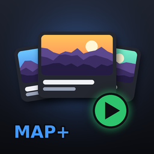

# Map Menu Plus

A new Levels menu for **BONELAB** (MelonLoader + BoneLib). Every map gets a big picture card with its mod.io thumbnail, author, downloads and rating, so you can see what a map looks like before you load it.

## Features

- **Picture cards**: 9 maps per page, each with its mod.io thumbnail, name, author, download count and rating.
- **Details page**: click a card to see a big picture and all of the mod's screenshots, plus the author, pack, last update, downloads, % liked and the description.
  - **PLAY** starts the map.
  - **FAVORITE** saves it to your favorites.
- **Library**: All Maps, Favorites, Recently Played, Not Played Yet, Mod Maps and BONELAB Maps.
- **Search** by name, pack or author, and **sort** by A-Z, Popular, Top Rated, Newest or Last Played.
- **SURPRISE ME** opens a random map. **YOU ARE IN** shows the map you are playing now.
- **Fusion**: lobby guests get **REQUEST MAP**, the same as the game's own page.
- **CLASSIC** switches back to the game's own Levels page.

## The mod.io login: what the mod does with it

The pictures and numbers come from the mod.io API, which needs a login. The mod uses the login BONELAB already has for its own mod browser; Fusion reads the same token the same way to download lobby mods.

- **Where it is read:** `Levels.cs` -> `ReadToken()`. It reads the `"mod.io.access_token"` value from the game's mod settings file (`Il2CppSLZ.Marrow.Forklift.ModDownloader.ModSettingsPath`).
- **Where it is used:** `ModIo.cs` -> `ApiGet()`. It is sent **only to `https://api.mod.io`**, as the `Authorization: Bearer` header, and only in read-only **GET** requests:
  - `GET /v1/games/3809/mods?id-in=...` gets info for the player's installed maps.
  - `GET /v1/games/3809/mods/{id}` is used for a map the list leaves out.
  - `GET /v1/games/3809/mods?name-lk=...` / `_q=...` finds maps that were installed by hand.
- **Never** written to disk, logged, or sent anywhere else. Picture downloads (`ModIo.DownloadOne`) go to mod.io's image CDN **without** the token.
- Players can switch it off: BoneMenu -> Map Menu Plus -> "Pictures + info from mod.io".
- Pictures and info are cached in `UserData/MapMenuPlus/modio`.

## Building

1. Start BONELAB once with MelonLoader, so `MelonLoader/Il2CppAssemblies` exists.
2. Install the .NET SDK (6 or newer).
3. Double-click `BUILD.bat`. It finds the game, builds the mod, and copies `MapMenuPlus.dll` into `BONELAB/Mods`.

See `INSTALL.txt` for the full steps. To make the Thunderstore package, run `thunderstore/MAKE_THUNDERSTORE_ZIP.bat` after building.

## Code layout

| File | What it does |
|---|---|
| `Mod.cs` | Entry point, level-load hooks |
| `Patches.cs` | Finds the game's Levels page (`LevelsPanelView`) |
| `Levels.cs` | Reads the map list, mod.io ids from the game's mod listings, the login token, and starts maps (through the page's own `SelectItem`) |
| `ModIo.cs`, `ModInfo.cs`, `Json.cs` | mod.io client on background threads, disk cache, small JSON parser |
| `Pictures.cs` | Turns downloaded pictures into textures (one per frame) |
| `MapMenu.cs`, `MapLayout.cs`, `Paint.cs`, `Shapes.cs`, `UiKit.cs` | The menu itself |
| `MapModel.cs`, `Store.cs` | Categories, search, sort, pages, favorites, play history |
| `Settings.cs` | MelonPreferences + BoneMenu page |
| `thunderstore/` | Thunderstore manifest, icon, page text, packaging script |

This mod was written with the help of an AI (Claude).
